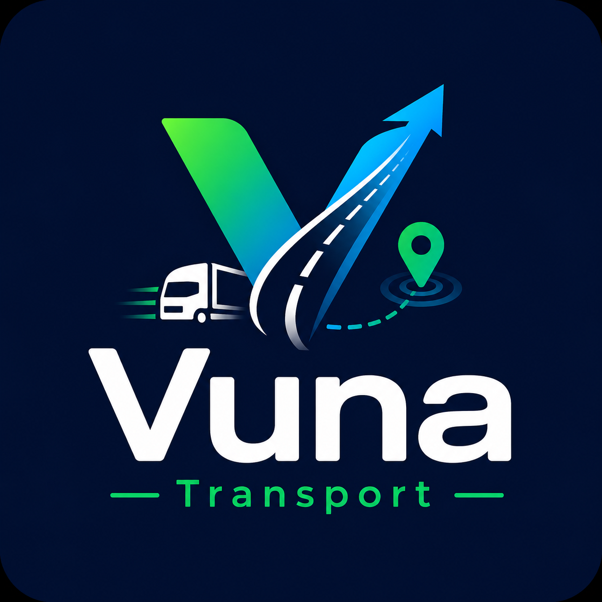

<div align="center">
  
  <h1>Vuna Transport</h1>
  <p>Transport planning, fleet allocation, deliveries and collections for ERPNext</p>

  <a href="https://github.com/navariltd/vuna_transport/actions/workflows/ci.yml?query=branch%3Aversion-16"></a>
</div>

## What it does

Vuna Transport coordinates customer deliveries, depot transfers, approved returns and supplier collections. Planners group work into Transport Loads, assign vehicles and drivers, and follow execution through Delivery Trips and Proof of Delivery.

ERPNext remains responsible for stock and accounting. Transport records link the planning and execution to the relevant Delivery Notes, Stock Entries and Purchase Receipts.

Use the application to:

- Plan full or partial quantities and check stock at the loading warehouse.
- Check vehicle capacity, refrigeration, availability and driver availability before dispatch.
- Prepare deliveries and depot transfers before the driver leaves.
- Record deliveries, pickups, rejected goods and custody using one proof workflow.
- Manage returns, inspections and approved shipment diversions.
- Preview road routes, optimize stop order and estimate transport costs.
- Give drivers assigned stops and tasks through the separate mobile application.

See the [feature overview](features.md) for the supported workflows.

## Stable releases and development

| Reference | Purpose |
| --- | --- |
| `version-16` | Stable release line for Frappe, ERPNext and HRMS v16 |
| `v16.0.0` | First release in that line; identifies one fixed commit |
| `develop` | Ongoing development; not the production installation branch |

The application version is `16.0.0`. The major version follows the supported ERPNext release line. Subsequent releases use tags such as `v16.0.1` and `v16.1.0`.

Develop changes on feature branches against `develop`. Promote reviewed, tested fixes and features to `version-16`, update the application version, and create a new release tag. Do not move an existing release tag to a different commit.

## How daily work fits together

The normal planned workflow is:

```text
Sales Order / Material Transfer Request / Return Request / Purchase Order
    → Transport Demand
    → Transport Load
    → Vehicle Allocation
    → Delivery Trip stops and tasks
    → Proof of Delivery or collection
    → Receipt, completion, or return follow-up
```

The exact stock-document timing depends on the movement and settings. Customer Delivery Notes and depot in-transit Stock Entries are prepared before dispatch. Supplier collections can receive company-owned goods into the vehicle warehouse, followed by transfer to the receiving warehouse. Approved pickups may also be assigned to an existing trip where supported, without creating a new planned allocation.

### Before the first dispatch

1. Prepare the ERPNext Company, Items, UOM conversions, warehouses, customers, suppliers and addresses.
2. Configure Vehicle Categories and Models, individual Vehicles, Drivers, and any required compliance documents. Link company-owned transport vehicles to their ERPNext Assets. Set the actual body configuration and refrigeration capability on each vehicle.
3. Link vehicles to their transit warehouses when goods will be held in vehicle stock. Configure depot returns/quarantine warehouses where needed.
4. Configure Delivery Methods, supported demand sources and approval requirements in Transport Settings. Sales demand also respects whether each Item requires transport.
5. Configure Delivery Groups, Transport Compatibility Groups, zones and routes as needed. Add cost structures and assignments if estimates are required.
6. Give planners, dispatchers, managers and drivers the appropriate access. Set up and approve mobile devices if using the driver app.

Then generate Transport Demand from eligible source documents, open Dispatch Planning, select the work and quantities to load, and proceed through allocation and dispatch.

### When execution differs from the plan

Record the actual accepted, rejected or collected quantities. Rejected goods require a reason and custody information; follow-up may involve a Return Request, receiving stock movement and Return Inspection. Use Shipment Diversion for an approved onward destination when the goods remain eligible for diversion.

A depot may also receive an in-transit transfer through ERPNext without a driver-entered proof. Supplier collection tasks can be reconciled from Purchase Receipts. Do not create duplicate stock receipts for work already received.

## Requirements and installation

Use a bench with Frappe, ERPNext and HRMS on their `version-16` branches. This package requires Python 3.14 or later, as declared in [pyproject.toml](pyproject.toml). Use the matching framework's other runtime requirements.

From an existing v16 bench, install missing dependencies first:

```bash
bench get-app --branch version-16 https://github.com/frappe/erpnext
bench get-app --branch version-16 https://github.com/frappe/hrms
bench --site your-site install-app erpnext
bench --site your-site install-app hrms
```

Install the stable application branch:

```bash
bench get-app --branch version-16 https://github.com/navariltd/vuna_transport
bench --site your-site install-app vuna_transport
bench --site your-site migrate
bench build --app vuna_transport
```

To install the exact initial release rather than the moving stable branch, use `--branch v16.0.0` in the `get-app` command. Existing app checkouts need an upgrade procedure rather than another `get-app`.

### Upgrading an existing site

Back up the database and files and test the upgrade on a restored staging site first. Use maintenance mode and pause writers while applying migrations. Follow the bench or hosting platform's normal update, asset-build and restart procedure.

Legacy sites using Delivery Order and Delivery Load are migrated to Transport Demand and Transport Load. The migration preserves supported history and stops for unresolved conflicts rather than deleting linked business documents. Review any reported conflicts before retrying; do not skip a failing migration to force the upgrade through.

The shipping-address repair updates only proven billing-first demand snapshots without load history. Existing demands with load history are left for review. Vehicle migrations copy unambiguous category body settings and refrigeration to individual vehicles; unresolved body configurations must be completed manually.

## Maps and the driver application

The [Vuna Transport mobile app](https://github.com/navariltd/vuna_transport_mobile) is maintained and released separately. Its version does not need to match the ERPNext-aligned backend version number.

Drivers can view assigned trips and tasks, record proof and collection outcomes, capture evidence and use the offline proof queue. Compatible Android releases also support native Google maps and in-app navigation. These are not continuous fleet-tracking features.

Google routing and native navigation are optional. Configure the site's routing settings, credentials, roles and usage limits before enabling them. The server routing key and platform-specific mobile Maps keys serve different purposes. Mobile keys are provisioned from the signed-in site and should be restricted to the relevant app identity. Provider charges belong to the Google Cloud project owning those credentials; application request limits are not billing caps.

OpenStreetMap display does not provide a self-hosted road-routing engine. Supported mobile releases open external directions when using that provider.

## Documentation and contribution

Read the [Vuna Transport documentation](https://docs.navari.co.ke/vunatransport/introduction) for operational guidance. Internal scenario files and customer-specific working notes are not part of the public documentation.

For development, use `develop`, install the hooks, and run the relevant checks before opening a PR:

```bash
pre-commit install
pre-commit run --all-files
bench --site your-test-site run-tests --app vuna_transport
```

CI validates application installation, backend tests, formatting, security rules and dependencies. Stable branch and `v16.*` tag pushes are checked as well as development changes and pull requests. Passing CI does not replace staging validation of your own data and settings.

## License

AGPL-3.0. See [license.txt](license.txt).
